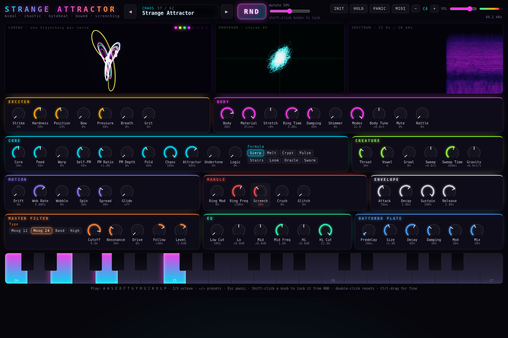

# Strange Attractor

A very strange polyphonic synthesizer for the web: **Rust + Dioxus** for the UI,
**Rust compiled to a bare wasm module running inside an AudioWorklet** for all
of the DSP. No JavaScript synthesis, no WebAudio oscillator nodes: the only JS
is ~70 lines of worklet glue.

It combines a morphing **modal resonator body** (string → tube → drum → plate →
bar → bell → glass → alien), a **stick-slip friction bow** that makes it
self-oscillate, a **Lorenz-attractor** chaos core, **bytebeat** "machine logic",
a **formant throat** with vocal-fry growl, a self-oscillating **screech**
resonator, glitch/crush mangling, and a master chain of a **Moog ladder**
(12/24 dB, band, high), **5-band EQ** and a **Dattorro plate reverb**.



## Run it

```sh
rustup target add wasm32-unknown-unknown
cargo install dioxus-cli        # or: cargo binstall dioxus-cli  (dx 0.7)
dx serve --platform web         # dev server with hot reload
dx bundle --platform web --release   # static build → target/dx/strange-attractor/release/web/public
```

Click **AWAKEN THE MACHINE** (browsers only allow audio after a gesture), then play.

| Input | Action |
|---|---|
| `A W S E D F T G Y H U J K O L P ; '` | play (two rows, like a piano) |
| `Z` / `X` | octave down / up |
| `←` / `→` | previous / next preset |
| `Esc` | panic |
| drag knob · `Ctrl`-drag · wheel | change value · fine · step |
| double-click knob | reset to default |
| **Shift-click knob / selector** | **lock it so RND leaves it alone** |
| **RND** | mutate every unlocked parameter by the *mutate* amount (100% = fully random) |
| HOLD / MIDI sustain | latch notes |
| MIDI button | enable Web MIDI (CC1 → Chaos, CC74 → Cutoff, CC64 → Hold) |

The patch, locks and selected preset survive a reload (localStorage).

## Architecture

```
crates/engine   pure Rust, zero dependencies: params, DSP, voices, presets (testable natively)
crates/worklet  cdylib exposing the engine as extern "C" fns → bare wasm with no imports
src/            Dioxus app: UI, visuals, WebAudio graph
assets/worklet.js  AudioWorkletProcessor: instantiates the DSP wasm, copies its output
build.rs        builds crates/worklet (separate target dir, scrubbed env) and embeds it
```

```
AudioWorkletNode ─► master gain ─► destination
 (Rust DSP wasm)      ├─► splitter ─► analyser L/R  → phosphor vectorscope
                      └─► analyser                  → spectrogram
          worklet ──telemetry (voices, envelopes, Lorenz state, peaks)──► UI
```

Voice: `exciters (strike, bow, breath, grit, core feed) → 12/24-partial modal body
→ rattle → growl → formant throat → ring mod → screech → VCA → spin/pan`.
The partials are complex one-pole (rotating phasor) resonators, so they keep
their amplitude while pitch sweeps, gravity and glide drag them around.

Master: `glitch → crush → drive → Moog ladder (envelope follower → cutoff) →
EQ → Dattorro plate → level → DC block → limiter`, with a NaN guard that resets
state instead of going permanently silent.

Visuals: a 3D Lorenz trajectory per sounding voice (the **Chaos** knob moves ρ
from 20 to 32: calm spirals into a fixed point turn into the butterfly), a
phosphor stereo XY scope, a scrolling log-frequency spectrogram, voice LEDs and
a background that breathes with the output level.

## Parameters (10 groups)

- *Exciter*: **Strike** — Mallet impulse into the body at note-on; **Hardness** — Mallet material: soft rubber ↔ steel hammer; **Position** — Where the body is struck — carves notches into the partials; **Bow** — Stick-slip friction bow; self-oscillates the body; **Pressure** — Bow pressure: silky glide ↔ grinding scrape; **Breath** — Pitch-tracked noise blown into the body; **Grit** — Rusty crackle impulses that keep pelting the body
- *Core*: **Core** — Direct level of the core oscillator; **Feed** — Core + logic signal driven into the body resonator; **Warp** — Phase-distortion bend (sine ↔ saw-ish); **Self-FM** — Oscillator modulates its own phase; **FM Ratio** — Modulator frequency ratio (inharmonic between integers); **FM Depth** — Modulator index; **Fold** — Sine wavefolder; **Chaos** — Lorenz attractor bends pitch, screech and audio; **Attractor** — Speed of the Lorenz attractor: slow drift ↔ audio-rate buzz; **Undertone** — Subharmonics at 1/2 and 1/3 of the pitch; **Logic** — Bytebeat machine-logic layer, pitch tracked; **Formula** — Which bytebeat expression the machine thinks
- *Body*: **Body** — Resonator output level; **Material** — Morph partial ratios: string → tube → drum → plate → bar → bell → glass → alien; **Stretch** — Squash or stretch the partial series; **Ring Time** — How long the body rings; **Damping** — High partials die faster (metal ↔ wood); **Shimmer** — Twin detuned partials that beat against each other; **Modes** — Number of active partials; **Body Tune** — Resonator pitch relative to the note; **Mute** — Palm-mute the body: short, dull, choked; **Rattle** — Loose contact buzz that feeds back into the body
- *Creature*: **Throat** — Formant filter amount; **Vowel** — Formant morph: beast → U → O → A → E → I; **Growl** — Vocal-fry roughness, period doubling and saturation; **Sweep** — Pitch envelope depth (decays to the note); **Sweep Time** — Pitch envelope time; **Gravity** — Pitch keeps falling (or rising) for as long as the note lives
- *Motion*: **Drift** — Drunken random-walk pitch wander; **Wob Rate** — Wobble LFO rate; **Wobble** — Throbbing pitch + amplitude wobble; **Spin** — Each voice orbits the listener (pan + doppler); **Spread** — Stereo spread of voices; **Glide** — Portamento from the previous note
- *Mangle*: **Ring Mod** — Ring modulator amount; **Ring Freq** — Ring modulator frequency (not key tracked); **Screech** — Feedback squeal resonator — self-oscillates past ~40%; **Crush** — Bit & sample-rate destruction; **Glitch** — Probability of stutter / reverse buffer repeats
- *Envelope*: **Attack** — Amplitude attack; **Decay** — Amplitude decay; **Sustain** — Amplitude sustain; **Release** — Amplitude release
- *Master Filter*: **Type** — Ladder filter mode; **Cutoff** — Filter cutoff; **Resonance** — Ladder feedback (self-oscillates at the top); **Drive** — Saturation into the ladder; **Follow** — Envelope follower → cutoff; **Level** — Patch output level
- *EQ*: **Low Cut** — 12 dB/oct high-pass; **Lo** — Low shelf @ 120 Hz; **Mid** — Mid peak gain; **Mid Freq** — Mid peak frequency; **Hi** — High shelf @ 6 kHz; **Hi Cut** — 12 dB/oct low-pass
- *Dattorro Plate*: **Predelay** — Time before the plate answers; **Size** — Tank delay scale; **Decay** — Tank feedback (near 100% ≈ freeze); **Damping** — High-frequency loss in the tank; **Mod** — Tank allpass modulation (chorusy shimmer); **Mix** — Dry/wet

## Factory presets

- **Init** (1): Init — Struck Bar
- **Metal** (10): Metal-on-Metal Screeching Industrial Elevator · Struck Bowed Metal Sheet · Resonating Metal Clothes Rack · Rusted Ship Hull · Anvil Choir · Gong of the Deep · Bent Saw Blade · Spring Tank Accident · Bridge Cable Twang · Scrap Yard Wind Chimes
- **Creature** (9): T-Rex Roar · Godzilla Laser Beam · Swamp Throat · Whale Lament · Kaiju Footstep · Banshee Wail · Goblin Chatter · Insect Swarm · Dragon Hatchling
- **Machine** (7): Thoughts of the Machine · Server Farm at 3AM · Dial-Up Prophecy · Broken Teletype · Factory Floor Loop · Robot Lullaby · Tape Machine Seizure
- **Space** (7): UFO Engine Room · Event Horizon · Pulsar Beacon · Alien Radio · Tractor Beam · Wormhole Choir · Satellite Tumble
- **Glass & Air** (6): Haunting Singing Glass · Frozen Lake Ping · Breath in a Bottle · Crystal Lattice · Ghost Flute · Wet Finger on the Rim
- **Strings & Sticks** (7): Hitting Muted Strings with a Plastic Pipe · Piano Wire Cathedral · Prepared Kalimba · Cello From Hell · Rubber Band Bass · Bowed Drum Skin · Sitar of Static
- **Percussion** (5): Junkyard Kick · Oil Drum Snare · Pipe Organ Tom · Glitched Hi-Hat · Thunder Sheet
- **Drones** (4): Cathedral of Rust · Subterranean Hum · Lorenz Garden · Neon Fog
- **Chaos** (4): Strange Attractor · Butterfly Effect · Feedback Cathedral · Fractal Accordion
- **Keys & Leads** (2): Haunted Rhodes · Mutant Lead

Preset levels were set by `cargo run --release -p sa-engine --example autolevel`
(RMS ≈ 0.09, peaks ≤ 0.7 with the limiter idle).

## Tests and tools

```sh
cargo test -p sa-engine --release                       # curves, filters, reverb, random patches stay finite
cargo run --release -p sa-engine --example presets      # level/CPU per preset (WAV_DIR=dir to write WAVs)
cargo run --release -p sa-engine --example probe -- Bow=1 Strike=0   # one-off parameter probes
cargo run --release -p sa-engine --example stress       # worst-case CPU, 8 voices, everything on
# browser tests (Playwright + Chromium), after `dx bundle --platform web --release`:
python3 tools/ui_test.py      target/dx/strange-attractor/release/web/public
python3 tools/preset_sweep.py target/dx/strange-attractor/release/web/public
```
